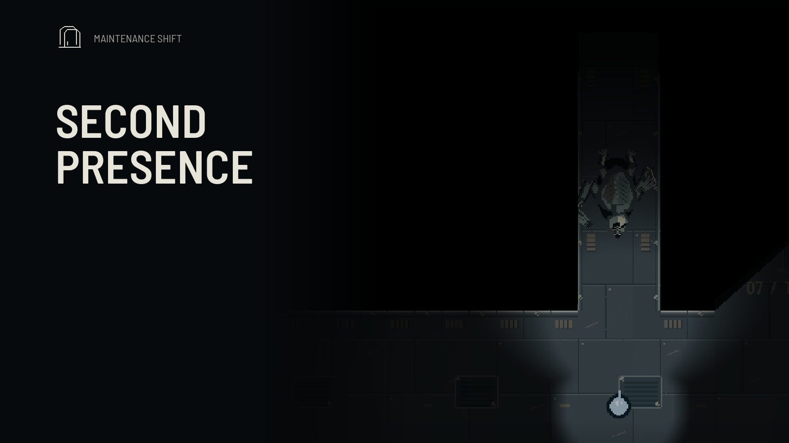

# Second Presence / İkinci Varlık

A top-down spaceship horror prototype. Keep the ship running through eight shifts, work through changing maintenance priorities, and find a way off a ship that will not stay quiet.

**Version 0.9 · Early prototype · Working title · English / Türkçe**



## Play

The downloadable Mac application is available on [itch.io](https://knorbay.itch.io/second-presence), free with optional donations, and from [GitHub Releases](https://github.com/knorbay/second-presence/releases). Download the ZIP, extract it in Finder, and move **Second Presence.app** into Applications. Python is not required for the packaged app.

- Universal Mac build: Apple Silicon and Intel; macOS 11 or later.
- Runtime tested on an Apple Silicon Mac. Intel binaries and dependencies are checked, but an Intel Mac has not been used for a runtime test.
- The app is ad-hoc signed, **not Apple-notarized**. macOS may block its first launch. See [Apple's instructions for opening a trusted app](https://support.apple.com/102445).
- Includes blood, creature violence and flashing lights.

## The game

Five maintenance jobs per shift, with two or three stages each. Six incident scenarios change the priority order, available rooms and puzzle targets. Some jobs can run in parallel; others depend on connected systems. Diagnostics, wiring, filters, valve balancing, startup sequences, cargo and fuel transfer use different inputs.

The first shift is quiet and fully lit. Power begins failing on the second shift, while irregular knocks and scraping carry through the ventilation. The creature begins hunting on the third shift after an opening warning period. Later shifts close passages, introduce faults and give the creature more information about your previous routes and hiding places. It tracks actual sight and sound; it does not know your position through walls.

Starting over creates a different incident plan. Loading a save preserves the current plan, puzzle targets and unfinished panel work.

## Controls

| Key | Action |
| --- | --- |
| WASD / arrow keys | Move; arrows adjust the active calibration panel |
| Shift / Ctrl | Run / crouch |
| E | Open a nearby panel or read a crew log |
| Left mouse | Operate panels, drag cables and cargo, hold the pump |
| 1 / 2 / 3 · Space | Panel inputs / confirm |
| F | Enter or leave a locker |
| B | Open or close a nearby bulkhead |
| G | Throw a noise decoy |
| Tab | Ship map and maintenance priorities |
| J | Crew logs |
| Escape / P | Close the panel / pause |
| L / M | Change language / mute |
| R / Q | Start over / quit at the ending screen |

The game keeps running while a panel, map or crew log is open. Press **P** to pause.

## Run from source

Python 3.13 is the tested development version. From this directory:

```sh
python3 -m venv .venv
.venv/bin/python -m pip install -r requirements.txt
.venv/bin/python main.py
```

On Windows, use `.venv\Scripts\python` instead of `.venv/bin/python`. Only a macOS application is packaged for this release.

```sh
SDL_VIDEODRIVER=dummy SDL_AUDIODRIVER=dummy .venv/bin/python -m unittest discover -s tests
```

Source saves live in `.user_data/`; the Mac application uses `~/Library/Application Support/Second Presence`. Saves and settings are excluded from source control and distribution. Starting a new campaign keeps the previous slot as `previous_save.json`.

## Türkçe

Sekiz vardiya boyunca gemiyi çalışır halde tut, değişen arızaları çöz ve kaçış kapsülünü hazırla. **Second Presence / İkinci Varlık geçici çalışma adıdır.** Oyun henüz geliştirme aşamasındaki bir prototiptir.

Her gün beş ana görev vardır. Altı arıza senaryosu görev önceliklerini, odaları ve bulmaca hedeflerini değiştirir. İlk gün gemiyi tanırsın. İkinci gün ışıklar kesilip gelir ve havalandırmadan düzensiz sesler duyulur; bu gün saldırı olmaz. Üçüncü günden itibaren av başlar. Genel aydınlatma kapanır, fenerle ilerlersin. Sonraki günlerde yollar kapanır ve yaratık önceki kaçış alışkanlıklarından yararlanır.

**Oyna / R** yeni bir deneme oluşturur. **Yükle**, aynı görev planını ve yarım kalan işlemleri sürdürür. **Tab** görevleri ve öncelikleri gösterir. **E** panel açar; fare, oklar, 1/2/3 ve Space işlemi yapar. **Shift** koşma, **Ctrl** çömelme, **F** saklanma, **B** kapı, **G** ses kapsülü, **J** kayıtlar, **P** duraklatma, **L** dil, **M** ses içindir.

Mac ZIP dosyasını Finder'da çıkarıp uygulamayı Applications klasörüne taşı. Paket Intel ve M serisini içerir; macOS 11 veya sonrası gerekir. Apple noterleştirmesi yoktur; ilk açılışta güvenlik uyarısı çıkabilir. Yukarıdaki Apple yönergesini yalnızca uygulamanın kaynağına güveniyorsan kullan.

## Credits and development

The game uses code-drawn ship environments, characters, interface and cover art. Audio includes CC0 samples from Kenney and Joth, plus locally generated and layered effects. Barlow Semi Condensed is bundled under the SIL Open Font License.

- [Audio credits and source links](assets/audio/CREDITS.md)
- [Font license](assets/fonts/OFL.txt)
- [Bundled runtime notices](packaging/UNIVERSAL-NOTICES.md)
- [Changes](CHANGELOG.md)

The title, visuals, pacing and balance remain in development.
